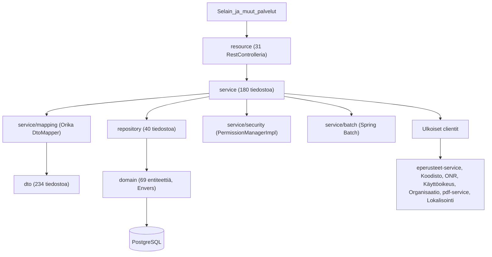
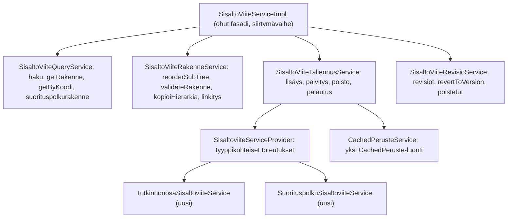
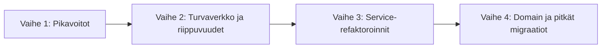

# eperusteet-amosaa-service - parannussuunnitelma

| Tieto | Arvo |
|---|---|
| Dokumentin luontipäivä | 22.10.2026 |
| Laatija | Cursor-agentti |
| Käytetty malli | Claude Opus 5.5 |
| Laajuus | `eperusteet-amosaa-service` (Spring Boot 4.1.1, Java 21, Spring Batch 6.0.5) |
| Koko | 632 Java-tiedostoa / noin 35 200 riviä (main), 41 tiedostoa / noin 6 000 riviä (test) |

Luvut perustuvat staattiseen koodianalyysiin (`wc -l`, hakulausekkeet, `mvn -o dependency:list`, käsin luetut luokat). Ne ovat suuntaa-antavia ja kannattaa tarkistaa ennen kunkin työn aloittamista.

---

## 1. Yhteenveto

Sovelluksen teknologinen pohja on ajantasainen: Spring Boot 4.1.1, Spring Framework 7.0.9, Hibernate 7.4.5, Flyway 12.11.0, springdoc 3.1.0 ja jakarta-nimiavaruus. Riippuvuudet tulevat samasta `eperusteet-parent-pom:4.1.1-11`-pomista kuin `eperusteet-service`issä, joten suuri osa riippuvuusvelasta on yhteistä. Tekninen velka johtuu pääosin seuraavista asioista:

1. **Suuret service-luokat.** `SisaltoViiteServiceImpl` on 1254 riviä ja `OpetussuunnitelmaServiceImpl` 1116 riviä (54 julkista metodia, 25 injektoitua riippuvuutta). Koulutustyyppikohtainen strategiamalli (`OpetussuunnitelmaDispatcher`) on olemassa, mutta ammatillisen koulutuksen logiikka on edelleen upotettuna näihin kahteen luokkaan.
2. **Riippuvuussyklit.** Koodissa on 32 `@Lazy`-annotaatiota 24 tiedostossa, ja `OpetussuunnitelmaServiceImpl` ja `JulkaisuServiceImpl` injektoivat toisensa suoraan. Sovellus vaatii asetuksen `spring.main.allow-circular-references=true`.
3. **Testit.** 27 testitiedostoa käyttää JUnit 4:ää, eikä JUnit 5:tä käytetä lainkaan. 16 integraatiotestiluokkaa ajetaan H2:lla ilman Flyway-migraatioita, ja controllereille ei ole yhtään testiä.
4. **Vanhentuneet ja päällekkäiset riippuvuudet.** Orika 1.5.4, kuusi OPH:n SNAPSHOT-kirjastoa, Jackson 2 ja 3 rinnakkain, HttpClient 4, commons-collections 3, Joda-Time sekä testikirjastoja compile-scopessa.

Suurin hyöty saadaan pilkkomalla `SisaltoViiteServiceImpl` ja `OpetussuunnitelmaServiceImpl`, purkamalla julkaisun ja opetussuunnitelman välinen sykli ja yhtenäistämällä julkaisun luonti, joka on nyt toteutettu kolmessa paikassa. Pienimmällä työllä saadaan pikavoittoja: korjataan eräajon ja asynkronisuuden konfiguraatio, poistetaan Joda-Time (vain 2 tiedostoa), korjataan virheet nielevät `catch`-lohkot ja siivotaan kuollut testiinfrastruktuuri.

---

## 2. Arkkitehtuuri

### 2.1 Kerrokset

| Paketti | Tiedostoja | Rivejä (noin) | Rooli |
|---|---:|---:|---|
| `dto` | 234 | 6 000 | API- ja siirto-oliot, joista 80 on `dto/peruste`-paketissa olevia eperusteiden DTO-kopioita |
| `service` | 180 | 14 500 | Liiketoimintalogiikka, validointi, mappaus, oikeudet, eräajot, ulkoiset clientit |
| `domain` | 112 | 7 800 | JPA-entiteetit, Envers-auditointi (`@Audited` 47 tiedostossa) |
| `repository` | 40 | 1 600 | Spring Data JPA, Criteria API (`OpetussuunnitelmaRepositoryImpl`), 7 natiivikyselyä |
| `resource` | 52 | 4 400 | REST-rajapinnat (springdoc), poikkeuskäsittely, Jackson-konfiguraatio |
| `config` | 13 | 900 | Tietoturva, async, Batch, Flyway, JPA, sessiot, ajastukset |

Service-paketin suurimmat alipaketit ovat `service/ops` (52 tiedostoa, noin 4 600 riviä), `service/koulutustoimija` (14 tiedostoa, noin 2 600 riviä) ja `service/external` (15 tiedostoa, noin 1 950 riviä).

### 2.2 Poikkileikkaavat ratkaisut

- **Tietoturva:** CAS (`spring-security-cas` ja `eperusteet-backend-utils`-kirjaston `OpintopolkuCasAuthenticationFilter`), `WebSecurityConfiguration` ja kehitysversio `WebSecurityConfigurationDev` (`local`-profiili). Metoditason oikeudet hoidetaan `@EnableMethodSecurity`-annotaatiolla ja `PermissionEvaluator`/`PermissionManagerImpl`-luokilla. Service-kerroksessa on 251 `@PreAuthorize`-annotaatiota ja resource-kerroksessa yksi. Sessiot tallennetaan Spring Session JDBC:llä (`SessionConfig`, 7200 sekuntia).
- **Välimuisti:** Spring Cache ja Ehcache 3 (JCache, `jcache.xml`, 14 välimuistia) sekä Hibernaten toisen tason välimuisti (`eperusteet-hibernate-ehcache.xml`). Service-kerroksessa on 15 `@Cacheable`-annotaatiota ja entiteeteillä 4. Välimuistien tyhjennys tehdään ohjelmallisesti `CacheManager`illa.
- **Ajastukset:** `ScheduledConfiguration` siivoaa CAS-sessiomappaukset tunneittain. `ScheduledService` täyttää koulutustoimijavälimuistin joka yö kello 04:00 pääkäyttäjän oikeuksilla. `ScheduledService`llä ei ole `@Profile`-rajausta, joten se on aktiivinen myös testikontekstissa.
- **Async:** `AsyncConfig` (`julkaisuTaskExecutor`), `DokumenttiAsyncConfig` (`docTaskExecutor`, 1 säie, jono 100) ja `DefaultConfigs` (`taskExecutor`). `@EnableAsync` on määritelty kolmessa luokassa. Tietoturvakonteksti välitetään `DelegatingSecurityContextAsyncTaskExecutor`illa.
- **Eräajot:** `spring-boot-starter-batch` on moduulin ainoa oma riippuvuus. `BatchConfig` määrittää kaksi jobia (`julkaisuJob` ja `perusteKoulutuksetMigrateJob`), joita käynnistetään `MaintenanceServiceImpl.kaynnistaJob`-metodilla ja `BatchController`ista.
- **Ulkoiset integraatiot:** `EperusteetClientImpl` ja `EperusteetServiceImpl` (eperusteet-service: perusteet, julkaisut, tiedotteet, arviointiasteikot), `KoodistoClientImpl`, `KayttajanTietoServiceImpl` ja `KayttooikeusServiceImpl` (ONR ja käyttöoikeuspalvelu), `OrganisaatioServiceImpl`, `ExternalPdfServiceImpl` (pdf-service) ja `LokalisointiServiceImpl`. Pääosa kutsuista kulkee `RestClientFactory`/`OphHttpClient`-luokkien kautta (8 tiedostoa), ja `RestTemplate`a käytetään 6 tiedostossa.
- **Integraatio eperusteisiin:** Amosaa hakee perusteet eperusteiden REST-rajapinnasta ja tallentaa koko perusteen JSON-merkkijonona `CachedPeruste`-entiteettiin. Eperusteet puolestaan kutsuu amosaan rajapintoja (`/api/tilastot/opetussuunnitelmat`, `/api/arviointiasteikot`, `/api/julkinen/kaikkijulkaistut` ja `/api/maintenance/paivita/koulutustoimija/oppilaitostyyppi`) `AmosaaClientImpl`-luokan kautta.
- **Tietokantamigraatiot:** Flywayssa on 113 SQL-migraatiota (`src/main/resources/db/migration`) eikä yhtään Java-migraatiota. Vanhemmat 39 migraatiota käyttävät juoksevaa numerointia (`V2_0`-`V2_x`) ja uudemmat 74 aikaleimaa (`V2_20261019160000`). Asetukset ovat `outOfOrder(true)` ja historiataulu `schema_version`.
- **CI:** `.github/workflows/build.yml` rakentaa käyttöliittymän (`eperusteet-amosaa-ui`), ajaa `mvn clean verify -Pit` ja rakentaa kontin `ci-tools`-työkaluilla. Code Climate -kattavuusraportointi on kommentoitu pois. Repositoriossa ei ole omaa Dockerfilea eikä riippuvuuksien päivitysseurantaa.

### 2.3 Havainnot

- Kerrosjako on selkeä, mutta service-kerros on paisunut: siinä on 41 % main-koodin riveistä.
- `spring.main.allow-circular-references=true` (`application.properties` rivi 6) piilottaa riippuvuussyklejä. Sama asetus on myös testien `application-docker.properties`-tiedostossa.
- `spring.main.allow-bean-definition-overriding=true` (rivi 5) sallii beanien hiljaisen korvaamisen.
- `spring.mvc.pathmatch.matching-strategy=ant-path-matcher` (rivi 16) on vanhentuva asetus, ja sen kommentti viittaa jo poistettuun Springfoxiin.
- `DefaultConfigs` rakentaa itse `EntityManagerFactory`n, `JpaTransactionManager`in ja Flyway-beanin. Boot-autokonfiguraatio ohitetaan, mikä vaikeuttaa Boot-päivityksiä.
- `DefaultConfigs` nostaa Jackson 2:n merkkijonorajan globaalisti 200 000 000 merkkiin (`StreamReadConstraints`), koska perusteiden JSON-sisällöt ovat suuria.
- Kaikki riippuvuudet tulevat ulkoisesta `eperusteet-parent-pom:4.1.1-11`-pomista, joten riippuvuuskorjaukset tehdään pääosin parent-pomiin ja ne koskevat myös `eperusteet-service`ä.

---

## 3. Sovelluslogiikka

### 3.1 Koulutustyyppikohtainen strategia

- `OpetussuunnitelmaDispatcher` valitsee toteutuksen `KoulutusTyyppi`- tai `OpsTyyppi`-arvon perusteella `OpetussuunnitelmaToteutus`-rajapinnan kautta. Rajapintoja ovat muun muassa `OpetussuunnitelmaCreateService`, `OpetussuunnitelmaPohjaCreateService`, `OpetussuunnitelmaValidationService`, `NavigationBuilder` ja `OpetussuunnitelmaPerustePaivitysService`. Toteutuksia on 25 luokkaa (ammatillinen, VST, TUVA, KOTO ja lukutaitokoulutus). Malli on hyvä.
- `SisaltoviiteServiceProvider` valitsee sisältöviitetyypin mukaisen toteutuksen VST-, TUVA- ja KOTO-sisällöille.
- Ammatillinen koulutus ei kuitenkaan käytä mallia johdonmukaisesti. `OpetussuunnitelmaServiceImpl.setOpsCommon` (95 riviä) haarautuu `KoulutustyyppiToteutus`-arvon mukaan if-ketjuilla, ja `alustaAmmatillinenOpetussuunnitelma` on yksityinen metodi samassa luokassa. `SisaltoViiteServiceImpl.updateSisaltoViite` käsittelee tyypit `TUTKINNONOSA` ja `SUORITUSPOLKU` itse, mutta delegoi muut tyypit `SisaltoviiteServiceProvider`ille.

### 3.2 Validointi

- `OpetussuunnitelmaServiceImpl.validoi` hakee koulutustyyppikohtaisen `OpetussuunnitelmaValidationService`n dispatcherilta. Jos sellaista ei ole, käytetään ammatillisen koulutuksen `ValidointiServiceImpl`iä (382 riviä).
- `ValidointiServiceImpl.validoiTutkinnonOsa` on 64 riviä, ja `SisaltoViiteServiceImpl.validateRakenne` on 72 riviä. Kummassakaan säännöt eivät ole erikseen testattavissa.
- Bean Validation on käytössä entiteeteillä (`domain/validation`, esim. `ValidHtml`), mutta controllereissa ei ole yhtään `@Valid`-annotaatiota.

### 3.3 Julkaisuvirta

```mermaid
flowchart LR
    tila["OpetussuunnitelmaServiceImpl.updateTila"] --> validoi1["validoi (dispatcher)"]
    validoi1 --> teeJulkaisu["JulkaisuServiceImpl.teeJulkaisu"]
    teeJulkaisu --> kesken["JulkaisuTila KESKEN (REQUIRES_NEW)"]
    kesken --> asyncJulkaisu["self.teeJulkaisuAsync (julkaisuTaskExecutor)"]
    asyncJulkaisu --> validoi2["validoi uudelleen"]
    validoi2 --> koodit["kooditaSisaltoviitteet"]
    koodit --> snapshot["getOpetussuunnitelmaKaikki, JSON-snapshot"]
    snapshot --> pdf["generateWithDto per kieli (docTaskExecutor)"]
    pdf --> tallennus["JulkaisuData (JSONB) ja Julkaisu"]
    tallennus --> valmis["Tila JULKAISTU, ops-navigation-välimuistin tyhjennys"]
```

- `JulkaisuServiceImpl` (545 riviä) sisältää validoinnin käynnistyksen, koodituksen, snapshotin, PDF-orkestroinnin ja tilan käsittelyn. Luokkatason `@Transactional` koskee myös pitkäkestoista async-metodia `teeJulkaisuAsync` (62 riviä).
- PDF:n generointi on itsessään `@Async`, joten `teeJulkaisuAsync`-metodin `catch (DokumenttiException e)` ei käytännössä koskaan laukea, eikä PDF-virhe näy julkaisun tilassa.
- Opetussuunnitelma validoidaan kahdesti: ensin `updateTila`ssa ja uudelleen async-säikeessä.
- Julkaisu luodaan kolmessa eri paikassa lähes samalla koodilla: `JulkaisuServiceImpl.teeJulkaisuAsync` (ja `aktivoiJulkaisu`), `MaintenanceServiceImpl.teeJulkaisu` (`@Deprecated`) ja eräajon `JulkaisuJobProcessor`.
- `JulkaisuServiceImpl` on merkitty `@Profile("!test")`, joten H2-testeissä se korvataan `JulkaisuServiceMock`illa.

### 3.4 Tilakone

- `Tila`-enum (`LUONNOS`, `VALMIS`, `POISTETTU`, `JULKAISTU`) määrittää sallitut siirtymät metodilla `mahdollisetSiirtymat(boolean isPohja)`. Pohjille `VALMIS`-tilasta ei sallita siirtymää `JULKAISTU`-tilaan.
- `OpetussuunnitelmaServiceImpl.updateTila` kutsuu kuitenkin aina parametritonta versiota `mahdollisetSiirtymat()`, joka käyttää arvoa `isPohja = false`. Pohjien rajoitus ei siis ole käytössä. Tarkista, onko tämä tarkoituksellista.
- Siirtymän ehdot (koulutustyyppi, julkaisut, OPH-pääkäyttäjä) ja sivuvaikutukset (validointi ja julkaisu) ovat yhdessä if-lausekkeessa `updateTila`-metodissa.
- Rinnalla on erilliset tilat `JulkaisuTila` (`JULKAISEMATON`, `KESKEN`, `JULKAISTU`, `VIRHE`) ja `DokumenttiTila`. Jumiin jääneet tilat havaitaan vasta luettaessa (`viimeisinJulkaisuTila` 60 minuutin ja `DokumenttiUtils.isTimePass` aikarajalla).

### 3.5 PDF-putki

`DokumenttiServiceImpl.generateWithDto` (`@Async("docTaskExecutor")` ja `REQUIRES_NEW`) kutsuu `ExternalPdfServiceImpl`iä, joka lähettää `OpetussuunnitelmaKaikkiDto`:n HTTP POST -pyynnöllä pdf-servicelle. Valmis PDF palautetaan takaisinkutsuna, joka tallennetaan metodilla `updateDokumenttiPdfData`. PDF:n generointi on hyvin eriytetty omaan palveluunsa. `DokumenttiServiceImpl`issä on kuitenkin käyttämätön `@Lazy self` -injektio ja `ExternalPdfServiceImpl`issä käyttämätön `@Lazy DokumenttiService` -injektio. `catch (Exception ex)` lokittaa vain virheviestin ilman pinoa (rivi 199).

### 3.6 Perusteiden välimuisti

- Perusteen sisältö tallennetaan `CachedPeruste`-entiteettiin JSON-merkkijonona, ja se puretaan tarvittaessa DTO:iksi (`EperusteetServiceImpl.getPerusteSisalto`, `perusteKaikki`-välimuisti).
- `CachedPeruste` luodaan kolmessa eri paikassa: `EperusteetServiceImpl` (rivi 115), `OpetussuunnitelmaServiceImpl.setOpsCommon` (rivi 580) ja `SisaltoViiteServiceImpl.addCachedPeruste` (rivi 197, FIXME "Muut saattavat haluta käyttää tätä myös").
- Eperusteiden DTO-rakenteet on kopioitu käsin `dto/peruste`-pakettiin (80 tiedostoa). Muutokset eperusteiden rajapinnassa pitää siis päivittää käsin.

### 3.7 Eräajot

- `BatchConfig` luo `TaskExecutorJobLauncher`in, jonka `ThreadPoolTaskExecutor`ia ei rekisteröidä beaniksi eikä alusteta (`initialize()`-kutsu puuttuu). Tällöin jobin käynnistys todennäköisesti epäonnistuu `IllegalStateException`illa. Koska `kaynnistaJob` on `@Async`, virhe näkyy vain lokissa. Tämä kannattaa varmistaa.
- `JobLauncher` on vanhentunut (deprecated) Spring Batch 6:ssa, ja sen korvaa `JobOperator`.
- Molemmat jobit ovat luonteeltaan kertaluonteisia migraatioita (massajulkaisu ja koulutuskoodien muunnos). Kannattaa arvioida, tarvitaanko Spring Batchia pysyvästi.

---

## 4. Servicet

### 4.1 Suurimmat luokat

| Luokka | Rivejä | Julkisia metodeja | `@Autowired` | Huomiot |
|---|---:|---:|---:|---|
| `service/ops/impl/SisaltoViiteServiceImpl` | 1254 | ~34 | 20 | Pisimmät metodit `addSisaltoViite` (93 riviä), `validateRakenne` (72 riviä) ja `updateTutkinnonOsa` (65 riviä). `@Transactional` kuudella private-metodilla. Tyyppikohtaiset `switch`-lauseet. Perii `AbstractLockService`n. |
| `service/koulutustoimija/impl/OpetussuunnitelmaServiceImpl` | 1116 | ~54 | 25 | `setOpsCommon` 95 riviä ja `addOpetussuunnitelma` 88 riviä. Kaksi `@Lazy`-injektiota ja setter-injektoitu `KoulutustoimijaService`. Suora sykli `JulkaisuService`n kanssa. Luokkatason `@Transactional` ilman `readOnly`-määritystä. Kaksi `catch (Exception)` -lohkoa, jotka lokittavat vain viestin (rivit 243 ja 259). Joda-Time. |
| `service/koulutustoimija/impl/JulkaisuServiceImpl` | 545 | ~12 | 16 | Kaksi `@Lazy`-injektiota (`KayttajanTietoService` ja `self`), luokkatason `@Transactional`, `@Profile("!test")`. `teeJulkaisuAsync` 62 riviä. Kaksi `catch (Exception)` -lohkoa. Joda-Time. |
| `service/external/impl/EperusteetServiceImpl` | 465 | ~23 | 10 | `getYksittaisenRakenteenSuoritustavat` 45 riviä. `CachedPeruste`n luonti, joka on toteutettu myös kahdessa muussa luokassa. |
| `service/ops/impl/ValidointiServiceImpl` | 382 | 2 | 5 | `validoiTutkinnonOsa` 64 riviä. Ammatillisen koulutuksen oletusvalidointi, jota ei ole siirretty dispatcherin taakse. |
| `service/external/impl/KayttajanTietoServiceImpl` | 355 | ~21 | 10 | Tyhjä `catch (RuntimeException ignored)` (rivit 270-271). `getKayttaja`-metodin oikeustarkistus on kommentoitu pois FIXME-merkinnällä (rivi 324). |
| `service/koulutustoimija/impl/KoulutustoimijaServiceImpl` | 346 | ~20 | 7 | Kaksi `@Lazy`-injektiota (`OrganisaatioService` ja `MaintenanceService`). |
| `service/external/impl/EperusteetClientImpl` | 298 | ~13 | 4 | `catch (Exception)` hukkaa alkuperäisen virheen (rivi 178). Käyttää HttpClient 4:n `URLEncodedUtils`ia. |
| `service/security/PermissionManagerImpl` | 289 | 1 | 0 | `hasPermission` 189 riviä. Riippuvuudet tulevat `AbstractPermissionManager`ilta kahdella `@Lazy`-injektiolla. |
| `service/util/impl/KoodistoClientImpl` | 277 | ~14 | 4 | Luokkatason `@Lazy`, `return null; // FIXME` (rivi 111), HttpClient 4:n `ContentType`. |
| `service/dokumentti/impl/DokumenttiServiceImpl` | 245 | ~12 | 7 | Käyttämätön `@Lazy self`. `@Async` ja `REQUIRES_NEW` samassa metodissa. `catch (Exception)` lokittaa vain viestin. |
| `service/mapping/DtoMapperConfig` | 243 | 1 | 4 | Orika-konfiguraatio, `dtoMapper`-metodi 163 riviä, kolme `@Lazy`-injektiota. |
| `service/util/impl/MaintenanceServiceImpl` | 201 | ~5 | 13 | Kolmas julkaisutoteutus (`teeJulkaisu`), `@Deprecated teeJulkaisut`, `printStackTrace` (rivi 162). |

### 4.2 Yleiset havainnot

- **Injektio:** `@Autowired` esiintyy 365 kertaa 115 tiedostossa. Service-paketin 87 beanista 73 käyttää kenttäinjektiota, ja resource-paketissa samoin tekee 25 tiedostoa. Konstruktori-injektiota ei käytetä service-kerroksessa lainkaan. Ainoa `@RequiredArgsConstructor`-käyttö on `OphSessionMappingStorageImpl`issä.
- **Syklit:** 32 `@Lazy`-annotaatiota 24 tiedostossa, joista 8 on controllereissa (6 tiedostoa). Lisäksi `OpetussuunnitelmaServiceImpl` ja `JulkaisuServiceImpl` injektoivat toisensa ilman `@Lazy`ä, mikä toimii vain sykliasetuksen ansiosta. Kaksi `@Lazy`-injektiota on täysin käyttämättömiä (`DokumenttiServiceImpl.self` ja `ExternalPdfServiceImpl.dokumenttiService`).
- **Transaktiot:** `@Transactional` on kuudella private-metodilla, jotka kaikki ovat `SisaltoViiteServiceImpl`issä. Annotaatio ei tee mitään, koska Spring AOP ei sieppaa luokan sisäisiä kutsuja. `OpetussuunnitelmaServiceImpl` ja `JulkaisuServiceImpl` käyttävät luokkatason kirjoitustransaktiota myös lukuoperaatioissa.
- **Async:** `DokumenttiAsyncConfig` toteuttaa `AsyncConfigurer`-rajapinnan, joten kaikki ilman nimeä merkityt `@Async`-metodit (`MaintenanceServiceImpl` kaksi kertaa ja `KayttajanTietoServiceImpl` kerran) ajetaan yksisäikeisessä `docTaskExecutor`issa PDF-töiden kanssa samassa jonossa. `julkaisuTaskExecutor` käyttää `ThreadPoolTaskExecutor`in oletusarvoja (yksi ydinsäie, rajaton jono).
- **Poikkeukset:** `catch (Exception`, `catch (RuntimeException` tai `catch (Throwable` esiintyy 11 kertaa 8 tiedostossa. Osa lohkoista nielee virheen kokonaan, ja `printStackTrace` esiintyy kahdesti.
- **Merkinnät:** TODO 10 kpl (9 tiedostossa), FIXME 5 kpl (5 tiedostossa), `@Deprecated` 24 kpl (14 tiedostossa), `System.out` 0 kpl.
- **Päällekkäisyys:** julkaisun luonti on kolmessa paikassa ja `CachedPeruste`n luonti kolmessa paikassa. `ObjectMapper` luodaan `new`-kutsulla tai `InitJacksonConverter`illa 21 kertaa 14 tiedostossa. `OpetussuunnitelmaServiceImpl` ja `JulkaisuServiceImpl` alustavat identtisen `objMapper`in omassa `@PostConstruct`-metodissaan.

### 4.3 Ehdotettu `SisaltoViiteServiceImpl`-luokan pilkkominen

Rajapinta `SisaltoViiteService` voidaan säilyttää siirtymävaiheen ajan, jolloin kutsujat eivät muutu. Toteutus delegoi uusille luokille, ja kutsujat siirretään vähitellen käyttämään niitä suoraan. Ammatillisen koulutuksen tutkinnon osat ja suorituspolut siirretään samaan `SisaltoviiteServiceProvider`-malliin, jota VST-, TUVA- ja KOTO-sisällöt jo käyttävät. `OpetussuunnitelmaServiceImpl` pilkotaan samalla periaatteella (luonti, tilasiirtymät, oikeudet ja haku), ja `alustaAmmatillinenOpetussuunnitelma` sekä `setOpsCommon`in ammatillinen haara siirretään `AmmatillinenOpetussuunnitelmaCreateService`en.

---

## 5. Testit

| Mittari | Arvo |
|---|---|
| Testitiedostoja | 41, joista 24 sisältää `@Test`-metodeja |
| `@Test`-metodeja | 111 |
| `@ParameterizedTest` | 0 |
| JUnit 4 | 27 tiedostoa (`SpringJUnit4ClassRunner` kolmessa pohjaluokassa, `MockitoJUnitRunner` kolmessa testissä) |
| JUnit 5 | 0 tiedostoa |
| Kirjastot | AssertJ (23 tiedostoa), Mockito (3 tiedostoa), Testcontainers JDBC-URL:n kautta |
| `@Ignore` / `@Disabled` / `Thread.sleep` | 2 / 0 / 0 |
| `@DirtiesContext` | 17 tiedostoa, joista 6 käyttää tilaa `AFTER_EACH_TEST_METHOD` |
| ArchUnit | Ei käytössä |
| JaCoCo | Konfiguroitu parent-pomissa (UT- ja IT-raportit erikseen), raportointi CI:ssä kommentoitu pois |

### 5.1 Testiinfrastruktuuri

| Pohjaluokka | Tietokanta | Käyttäjiä |
|---|---|---:|
| `AbstractIntegrationTest` | H2 in-memory (`it-test-context.xml`, `hbm2ddl.auto=create`, ei Flywayta) | 16 |
| `AbstractDockerIntegrationTest` | Testcontainers PostgreSQL 15.7 (`TestConfiguration`, `it-docker-test-context.xml`, Flyway) | 1 (`JulkaisuServiceDockerIT`, myös `@SpringBootTest`) |
| `AbstractWebIntegrationTest` | H2 ja `it-test-web-context.xml` (MockMvc) | 0 |
| `MockitoJUnitRunner` | Ei tietokantaa | 3 |

### 5.2 Havainnot

- Oletusintegraatiotestit ajetaan H2:lla, ja skeema luodaan Hibernaten `create`-tilassa. Flyway-migraatioita ei ajeta lainkaan H2-testeissä, joten migraatiot tulevat testatuksi vain yhdessä Docker-testiluokassa.
- `JulkaisuRepository`n viisi natiivikyselyä (JSONB) ja oikea `JulkaisuServiceImpl` testataan vain `JulkaisuServiceDockerIT`issä (3 testiä).
- Controllereita on 31, eikä niillä ole yhtään testiä. MockMvc on käytössä vain `AbstractWebIntegrationTest`issä, jota mikään testi ei peri.
- Oikeat integraatiot (`EperusteetClientImpl`, `OrganisaatioServiceImpl`, `KayttooikeusServiceImpl`, `KoodistoClientImpl` ja `DokumenttiServiceImpl`) on rajattu `default`-profiiliin ja korvattu testeissä mockeilla. Tämä on hyvä käytäntö, mutta HTTP-kutsujen muodostusta ja virheenkäsittelyä ei testata.
- Testeissä ei viitata lainkaan luokkiin `PermissionManagerImpl` (testataan vain epäsuorasti `AmosaaAppRolesIT`issä), `TermistoService`, `TiedoteService`, `OsaAlueService`, `OpetussuunnitelmaAikatauluService`, `KommenttiService`, `TekstiKappaleService`, `LockManager`, `OpetussuunnitelmaMuokkaustietoService` ja `ExternalPdfService`.
- Kuollutta testiinfrastruktuuria: `it-db-test-context.xml` (viittaa Flyway 2 -aikaiseen luokkaan `com.googlecode.flyway.core.Flyway`), `typedefs-h2.xml` ja `typedefs-pg.xml` (viittaavat Hibernate 6:ssa poistettuun `PostgresUUIDType`en), `AbstractWebIntegrationTest` ja `it-test-web-context.xml`.
- `HtmlValidationTest` on kokonaan ohitettu (`@Ignore("linkkivalidointi otettu pois kaytosta")`), ja `SisaltoViiteServiceIT`issä on yksi ohitettu testi.
- `@DirtiesContext(classMode = AFTER_EACH_TEST_METHOD)` kuudessa luokassa luo Spring-kontekstin uudelleen jokaisen testin jälkeen, mikä hidastaa testiajoa merkittävästi.
- Testikoodia on noin 6 000 riviä eli noin 17 % main-koodin määrästä.

---

## 6. Riippuvuudet

Riippuvuudet periytyvät lähes kokonaan parent-pomista `eperusteet-parent-pom:4.1.1-11`, joka on sama kuin `eperusteet-service`issä. Moduulin oma `pom.xml` lisää vain `spring-boot-starter-batch`-riippuvuuden. Versiot on tarkistettu komennolla `mvn -o dependency:list`.

| Riippuvuus | Versio | Ongelma |
|---|---|---|
| Orika (`orika-core`) ja transitiiviset `javassist` ja `paranamer` | 1.5.4 / 3.24.0-GA / 2.8 | Hylätty projekti, joka perustuu ajonaikaiseen bytecode-generointiin. Käytössä 10 tiedostossa, ja `DtoMapperConfig` on 243 riviä. Mappausvirheet näkyvät vasta ajon aikana. |
| OPH SNAPSHOT -kirjastot | `eperusteet-backend-utils` 3.3-SNAPSHOT, `java-http` 1.0.2-SNAPSHOT, `java-properties` 1.0.0-SNAPSHOT, `opintopolku-cas-servlet-filter` 1.0.1-SNAPSHOT, `opintopolku-user-details-service` 0.5.2-SNAPSHOT, `auditlogger` 9.2.7-SNAPSHOT | Buildit eivät ole toistettavia, ja tuotantoon voi päätyä tarkistamatonta koodia. `eperusteet-backend-utils`ia käytetään 15 tiedostossa (`RestClientFactory`, CAS-suodatin, revisiokommentit). |
| JUnit 4 ja `junit-vintage-engine` | 4.13.2 / 6.0.3 | 27 testitiedostoa käyttää JUnit 4:ää vintage-moottorin kautta, eikä yksikään JUnit 5:tä. JUnit 4 ei enää kehity. |
| Joda-Time ja `jackson-datatype-joda` | 2.12.7 / 2.21.5 | Korvattu `java.time`-rajapinnalla jo Java 8:ssa. Käytössä vain 2 tiedostossa (`DateTime.now().getMillis()`). |
| Jackson 2 (`com.fasterxml`) ja Jackson 3 (`tools.jackson`) | 2.21.5 / 3.1.5 | Boot 4:n oletus on Jackson 3, mutta sovellus käyttää Jackson 2:ta `spring-boot-jackson2`-moduulin kautta (165 tiedostoa). Kaksi JSON-pinoa samassa sovelluksessa. |
| Apache HttpClient 4 (`httpclient`, `httpclient-cache`, `httpcore`) ja HttpCore 5 | 4.5.13 / 4.4.16 / 5.4.3 | Versio 4.x on elinkaarensa lopussa. Amosaan koodi käyttää HttpClient 4:ää suoraan 4 tiedostossa (`ContentType`, `URLEncodedUtils`, `BasicNameValuePair`). |
| commons-collections | 3.2.2 | Elinkaarensa lopussa, ja kirjastolla on historiaa deserialisointihaavoittuvuuksista. Käytössä 14 tiedostossa (`CollectionUtils`). `commons-collections4` ei ole käytössä. |
| commons-digester (transitiivinen, `commons-validator` 1.7) | 2.1 | Erittäin vanha. `commons-validator`ia käytetään yhdessä tiedostossa. |
| `commons-text` | 1.10.0 | Vanha versio. Käytössä yhdessä tiedostossa. |
| `spring-boot-properties-migrator` | 4.1.1 | Tarkoitettu vain migraation ajaksi, mutta on ajonaikaisessa classpathissa (runtime-scope). |
| `mockito-core`, `jacoco-maven-plugin`, `easy-random` | 5.23.0 / 0.8.14 / 4.1.0 | Compile-scopessa, joten ne päätyvät tuotanto-JARiin. Amosaan main-koodi ei käytä niitä. |
| commons-dbcp2 | 2.14.0 | Compile-scopessa, vaikka amosaa käyttää sitä vain H2-testikontekstissa. Tuotannossa käytetään HikariCP:tä. |
| Spring Batch | 6.0.5 | Ajantasainen, mutta `BatchConfig` käyttää Spring Batch 6:ssa vanhentunutta `JobLauncher`ia. |
| Gson, PDFBox, Batik (osat), StreamEx, `hypersistence-utils`, `jackson-dataformat-toml`, `spring-plugin-core` | 2.13.2 / 2.0.29 / 1.13 / 0.6.5 / 3.15.3 / 2.21.5 / 3.0.0 | Amosaan main-koodissa ei ole yhtään importia näistä kirjastoista. Ne tulevat parent-pomista ja kasvattavat riippuvuuspuuta. Tarkista ennen poistoa, tarvitseeko `eperusteet-backend-utils` niitä. |
| `javax.el` (testit) | 3.0.0 | Vanha javax-nimiavaruus testiclasspathissa. |

Positiivista: Spring Boot, Spring Framework, Hibernate, Flyway, PostgreSQL-ajuri (42.7.13), Guava (33.7.1), Testcontainers (2.0.5) ja springdoc ovat ajan tasalla. Jakarta-migraatio on tehty, ja jäljellä olevat 4 `javax.*`-importia ovat JDK:n omia rajapintoja (`javax.sql`, `javax.imageio`). Springfoxia ei enää käytetä.

---

## 7. Parannusehdotukset

Asteikot:

- **Vaikutus:** Korkea / Keski / Matala. Kuvaa hyötyä ylläpidettävyydelle, luotettavuudelle tai tietoturvalle.
- **Kriittisyys:** Kriittinen / Korkea / Keski / Matala. Kuvaa, kuinka kiireellinen korjaus on riskin kannalta.
- **Työmäärä:** S (alle 2 päivää), M (noin 1 viikko), L (2-4 viikkoa), XL (yli 1 kuukausi).

### 7.1 Service-luokkien refaktorointi

| ID | Alue | Ehdotus | Perustelu / havainto | Vaikutus | Kriittisyys | Työmäärä |
|---|---|---|---|---|---|---|
| R1 | Service | Pilko `SisaltoViiteServiceImpl` osiin: `SisaltoViiteQueryService`, `SisaltoViiteRakenneService`, `SisaltoViiteTallennusService` ja `SisaltoViiteRevisioService`. Säilytä `SisaltoViiteService` fasadina siirtymän ajan. | 1254 riviä, noin 34 julkista metodia ja 20 riippuvuutta. Luokka sisältää haun, CRUD-toiminnot, rakenteen järjestelyn ja validoinnin, hierarkian kopioinnin, linkityksen, revisiot ja perusteiden välimuistin. Muutosten riskit ja yhdistämiskonfliktit kasaantuvat tähän luokkaan. | Korkea | Kriittinen | L |
| R2 | Service | Pilko `OpetussuunnitelmaServiceImpl`: luonti (`addOpetussuunnitelma`, `setOpsCommon`), tilasiirtymät (`updateTila`), käyttöoikeudet (`updateOikeus`, `getOikeudet`) ja haku omiin luokkiinsa. Siirrä `alustaAmmatillinenOpetussuunnitelma` `AmmatillinenOpetussuunnitelmaCreateService`en. | 1116 riviä, noin 54 julkista metodia ja 25 riippuvuutta. Luokka on solmukohta, josta riippuvat julkaisu, koulutustoimija, PDF ja ylläpito. | Korkea | Korkea | L |
| R3 | Service | Siirrä ammatillisen koulutuksen haarat strategioihin: `setOpsCommon`in `KoulutustyyppiToteutus`-if-ketjut `OpetussuunnitelmaDispatcher`in taakse sekä `SisaltoViiteServiceImpl`in `TUTKINNONOSA`- ja `SUORITUSPOLKU`-käsittely `SisaltoviiteServiceProvider`in toteutuksiksi. | Strategiamalli on jo käytössä 25 luokassa VST-, TUVA- ja KOTO-koulutuksille, mutta ammatillinen logiikka on edelleen kovakoodattuna service-luokissa. Uuden tyypin lisääminen vaatii muutoksia moneen paikkaan. | Korkea | Korkea | M |
| R4 | Service | Pura syklit: `OpetussuunnitelmaServiceImpl` ja `JulkaisuServiceImpl` (julkaisun käynnistys `ApplicationEvent`illa tai erillisellä orkestraattorilla), `OpetussuunnitelmaServiceImpl` ja `KoulutustoimijaService` (setter-injektio) sekä `KayttajanTietoServiceImpl` ja `KoulutustoimijaService`. Poista `@Lazy`-injektiot ja lopuksi asetus `spring.main.allow-circular-references=true`. | 32 `@Lazy`-annotaatiota 24 tiedostossa. Sykliasetus sallii uudet syklit huomaamatta, ja syklit estävät luokkien itsenäisen testaamisen. | Korkea | Korkea | L |
| R5 | Service | Yhtenäistä julkaisun luonti yhteen `JulkaisuSnapshotWriter`-luokkaan, jota käyttävät `JulkaisuServiceImpl`, `MaintenanceServiceImpl` ja `JulkaisuJobProcessor`. Poista luokkatason `@Transactional` async-metodista, poista kaksinkertainen validointi ja kirjaa PDF-virheet julkaisun tilaan. | Julkaisu luodaan kolmessa paikassa lähes samalla koodilla. Pitkä transaktio async-säikeessä pitää yhteyttä varattuna, ja `DokumenttiException`-käsittely ei laukea, koska PDF-generointi on asynkroninen. | Korkea | Korkea | M |
| R6 | Service | Kokoa `CachedPeruste`n luonti yhteen `CachedPerusteService`-luokkaan (nyt `EperusteetServiceImpl`, `OpetussuunnitelmaServiceImpl` ja `SisaltoViiteServiceImpl`). | Kolme toteutusta eroavat toisistaan hakuehdoissa (`findFirstByPerusteIdAndLuotu` ja `findOneByDiaarinumeroAndLuotu`) ja täytettävissä kentissä. Koodissa on asiasta FIXME. | Keski | Keski | S |
| R7 | Transaktiot | Poista `@Transactional` `SisaltoViiteServiceImpl`in kuudelta private-metodilta. Jos rajaa tarvitaan, siirrä metodi erilliseen beaniin. Lisää `readOnly = true` lukuoperaatioille `OpetussuunnitelmaServiceImpl`issä ja `JulkaisuServiceImpl`issä. | Annotaatio ei vaikuta private-metodeihin, joten se antaa väärän käsityksen transaktiorajoista. Esimerkiksi `addCachedPeruste` on merkitty `readOnly = false`, vaikka luokan oletus on `readOnly = true`. | Keski | Korkea | S |
| R8 | Virheenkäsittely | Korjaa tyhjä `catch` `KayttajanTietoServiceImpl`issä (rivit 270-271), pelkän viestin lokittavat lohkot (`OpetussuunnitelmaServiceImpl` rivit 243 ja 259, `DokumenttiServiceImpl` rivi 199), alkuperäisen virheen hukkaava `EperusteetClientImpl` (rivi 178) ja kaksi `printStackTrace`-kutsua. | Virheet katoavat hiljaa tai niiden syy jää lokista pois, mikä vaikeuttaa tuotantovikojen selvittämistä. | Keski | Korkea | S |
| R9 | Oikeudet | Palauta tai korvaa `KayttajanTietoServiceImpl.getKayttaja`-metodin kommentoitu oikeustarkistus. Muuta `PermissionManagerImpl.hasPermission` (189 riviä) datapohjaiseksi oikeustaulukoksi ja kirjoita sille yksikkötestit. | Käyttäjätietojen haku ilman koulutustoimijatarkistusta on mahdollinen tietovuoto. Oikeuslogiikka on tietoturvakriittistä, ja pitkässä haarautuvassa metodissa virheet on helppo ohittaa. | Korkea | Korkea | M |
| R10 | DI | Siirry kenttäinjektiosta konstruktori-injektioon (`@RequiredArgsConstructor`). Aloita R1-R5:n refaktoroitavista luokista. | 73/87 service-beania ja 25 resource-paketin tiedostoa käyttää kenttäinjektiota. Riippuvuuksien määrä ei näy, yksikkötestaus ilman Spring-kontekstia on hankalaa ja syklit jäävät piiloon. | Keski | Matala | L |
| R11 | Async ja Batch | Alusta `BatchConfig`in `ThreadPoolTaskExecutor` (tai käytä Spring-beania) ja siirry `JobOperator`iin. Yhdistä kolme `@EnableAsync`-määritystä, anna `julkaisuTaskExecutor`ille eksplisiittiset rajat ja nimeä executor kaikissa `@Async`-käytöissä. | Alustamaton executor todennäköisesti kaataa jobin käynnistyksen. `AsyncConfigurer` ohjaa nimeämättömät `@Async`-kutsut yksisäikeiseen PDF-executoriin. | Keski | Korkea | S |
| R12 | Siivous | Poista käyttämättömät injektiot (`DokumenttiServiceImpl.self` ja `ExternalPdfServiceImpl.dokumenttiService`) ja korvaa 21 paikallista `ObjectMapper`-instanssia (14 tiedostoa) injektoitavalla, keskitetysti konfiguroidulla mapperilla. | Käyttämättömät `@Lazy`-injektiot ylläpitävät näennäisiä syklejä. Hajautetut mapperit johtavat epäjohdonmukaiseen JSON-käsittelyyn ja vaikeuttavat Jackson 3 -migraatiota. | Matala | Matala | S |
| R13 | Validointi | Jaa `ValidointiServiceImpl.validoiTutkinnonOsa` (64 riviä) ja `SisaltoViiteServiceImpl.validateRakenne` (72 riviä) sääntökohtaisiksi validaattoreiksi ja siirrä ammatillinen oletusvalidointi `OpetussuunnitelmaValidationService`-toteutukseksi. | Yksittäisiä sääntöjä on nyt vaikea testata, ja ammatillinen validointi ohittaa dispatcher-mallin. | Keski | Keski | M |

### 7.2 Riippuvuudet

| ID | Alue | Ehdotus | Perustelu / havainto | Vaikutus | Kriittisyys | Työmäärä |
|---|---|---|---|---|---|---|
| D1 | Mappaus | Korvaa Orika MapStructilla vaiheittain domain-alue kerrallaan ja pilko `DtoMapperConfig` (243 riviä). | Orika on hylätty projekti, ja sen ajonaikainen bytecode-generointi (javassist 3.24.0-GA) on riski tuleville Java- ja Hibernate-päivityksille. MapStruct tarkistaa mappaukset käännösaikana. Sama `DtoMapper`-rajapinta voidaan säilyttää siirtymän ajan. Amosaassa käyttö on suppeampaa kuin eperusteissa (10 tiedostoa), joten amosaa sopii pilotiksi. | Korkea | Korkea | L |
| D2 | Build | Korvaa SNAPSHOT-riippuvuudet julkaistuilla versioilla (`eperusteet-backend-utils`, `java-http`, `java-properties`, `opintopolku-cas-servlet-filter`, `opintopolku-user-details-service`, `auditlogger`). | Buildit eivät ole toistettavia. CAS-suodatin ja audit-loki ovat tietoturvakriittisiä, ja niiden versio voi vaihtua huomaamatta. | Korkea | Kriittinen | M |
| D3 | Testit | Migroi JUnit 4 -testit JUnit 5:een, korvaa XML-testikontekstit Java-konfiguraatiolla tai `@SpringBootTest`-slice-testeillä ja poista `junit-vintage-engine` sekä `junit:junit`. | 27 testitiedostoa käyttää JUnit 4:ää, eikä yksikään JUnit 5:tä. Testejä on vähän (111), joten migraatio on kohtuullisen kokoinen ja mahdollistaa parametrisoidut testit. | Keski | Keski | M |
| D4 | Aika | Poista Joda-Time (2 tiedostoa, `DateTime.now().getMillis()`) ja `jackson-datatype-joda`. | Joda-Time on ylläpitotilassa, ja korvaus on suoraviivainen (`System.currentTimeMillis()` tai `Instant`). | Matala | Keski | S |
| D5 | JSON | Migroi Jackson 2:sta Jackson 3:een (Boot 4:n oletus) ja poista `spring-boot-jackson2`. Siirrä `StreamReadConstraints`-asetus keskitettyyn mapper-konfiguraatioon. | Kaksi JSON-pinoa rinnakkain. Jackson 2 -tuki Bootissa on siirtymäratkaisu. Jackson 2:ta käytetään 165 tiedostossa, joten työ kannattaa tehdä R12:n jälkeen. | Keski | Keski | L |
| D6 | HTTP | Poista HttpClient 4:n suorat käytöt (4 tiedostoa) ja korvaa ne Springin `MediaType`- ja `UriComponentsBuilder`-luokilla. Korvaa `RestTemplate` (6 tiedostoa) `RestClient`illä. Poista HttpClient 4.5.13 parent-pomista, kun `java-http` ei enää tarvitse sitä. | Versio 4.x on elinkaarensa lopussa. Kaksi HTTP-asiakasta tarkoittaa kahta konfiguraatiota ja kahta tietoturvapäivitysten seurantaa. | Keski | Keski | M |
| D7 | Commons | Korvaa `commons-collections` 3.2.2 (14 tiedostoa) Springin tai `commons-collections4`:n `CollectionUtils`illa. Päivitä `commons-validator`, jotta `commons-digester` 2.1 poistuu, ja päivitä `commons-text`. | Vanhat versiot. Commons-collections 3:lla on historiaa deserialisointihaavoittuvuuksista. Korvaus on mekaaninen. | Matala | Keski | S |
| D8 | Build | Korjaa scopet parent-pomissa: `mockito-core`, `easy-random` ja `jacoco-maven-plugin` pois compile-scopesta (test-scope tai pelkkä plugin) ja `commons-dbcp2` test-scopeen. | Testikirjastot päätyvät tuotanto-JARiin, mikä kasvattaa hyökkäyspintaa ja JARin kokoa. | Keski | Korkea | S |
| D9 | Konfiguraatio | Poista `spring-boot-properties-migrator`, `spring.mvc.pathmatch.matching-strategy=ant-path-matcher` ja `spring.main.allow-bean-definition-overriding=true`. Tarkista, toimivatko polkumallit `PathPatternParser`illa. | Migraatiotyökalu ei kuulu tuotantoon. Ant-path-matcherin perusteluna oleva Springfox on jo poistettu. Beanien korvaaminen piilottaa konfiguraatiovirheitä. | Matala | Keski | S |
| D10 | Kirjastot | Siirrä parent-pomista moduulikohtaisiksi ne kirjastot, joita amosaa ei käytä: Gson, PDFBox, Batik, StreamEx, `hypersistence-utils`, `jackson-dataformat-toml` ja `spring-plugin-core`. Poista testien `javax.el`. | Amosaan main-koodissa ei ole importeja näistä kirjastoista. Turhat kirjastot kasvattavat riippuvuuspuuta ja tietoturvaseurannan työtä. | Matala | Matala | M |
| D11 | Batch | Arvioi Spring Batchin tarve. Jos jobit ovat kertaluonteisia migraatioita, korvaa ne ylläpitorajapinnalla tai Flyway-Java-migraatiolla ja poista `spring-boot-starter-batch`. Muussa tapauksessa siirry `JobOperator`iin. | Batch tuo omat metataulunsa ja konfiguraationsa kahta jobia varten. `JobLauncher` on vanhentunut Spring Batch 6:ssa. | Matala | Matala | S |
| D12 | Build | Lisää riippuvuuksien automaattinen päivitysseuranta (Dependabot tai Renovate) ja haavoittuvuusskannaus sekä tähän repositorioon että parent-pomiin. | Riippuvuudet ovat parent-pomissa, joten niiden vanheneminen ei näy tässä repositoriossa. `.github`-hakemistossa ei ole päivitysseurannan konfiguraatiota. | Keski | Keski | S |

### 7.3 Testit

| ID | Alue | Ehdotus | Perustelu / havainto | Vaikutus | Kriittisyys | Työmäärä |
|---|---|---|---|---|---|---|
| T1 | Testit | Ota Testcontainers PostgreSQL integraatiotestien oletukseksi H2:n sijaan ja luo skeema Flywaylla `hbm2ddl.auto=create`-asetuksen sijaan. | 16 testiluokkaa ajetaan H2:lla ilman migraatioita. H2 ei vastaa PostgreSQL:ää (natiivikyselyt ja JSONB `JulkaisuRepository`ssa), ja migraatiovirheet jäävät huomaamatta. | Korkea | Korkea | M |
| T2 | Testit | Lisää controller-testejä (`@WebMvcTest` tai MockMvc), erityisesti oikeustarkistuksille, sekä testit service-luokille, joilla niitä ei ole (`TermistoService`, `TiedoteService`, `OsaAlueService`, `KommenttiService`, `TekstiKappaleService`, `OpetussuunnitelmaMuokkaustietoService`, `ExternalPdfService`). | 31 controllerilla ei ole yhtään testiä. Refaktorointi (R1-R5) vaatii kattavan regressiosuojan. | Keski | Keski | L |
| T3 | Arkkitehtuuri | Lisää ArchUnit-säännöt: kerrosriippuvuudet (resource ei saa käyttää repositorya), syklien kielto pakettitasolla, kenttäinjektion kielto uusissa luokissa ja luokkakoon raja. | Kolme controlleria (`BatchController`, `DokumenttiController`, `TutkinnonOsaController`) käyttää repositorya suoraan. Säännöt estävät velan kasvun uudelleen refaktoroinnin jälkeen. | Keski | Matala | S |
| T4 | Testit | Luo ennen R1-R5:n aloittamista karakterisointitestit julkaisuvirralle, opetussuunnitelman luonnille kaikilla koulutustyypeillä ja perusteen päivitykselle. Testit vertaavat julkaistun JSON-snapshotin rakennetta. | Oikea `JulkaisuServiceImpl` on katettu vain kolmella Docker-testillä. Julkaisun snapshot on julkisen käyttöliittymän ja eperusteiden tilastojen tietolähde. | Korkea | Korkea | M |
| T5 | Testit | Poista kuollut testiinfrastruktuuri (`it-db-test-context.xml`, `typedefs-h2.xml`, `typedefs-pg.xml`, `AbstractWebIntegrationTest`, `it-test-web-context.xml`), ratkaise kaksi `@Ignore`-testiä ja vähennä `AFTER_EACH_TEST_METHOD`-tilan `@DirtiesContext`-käyttöä (6 luokkaa). | Vanhentuneet tiedostot viittaavat poistettuihin luokkiin ja johtavat harhaan. Kontekstin uudelleenluonti jokaisen testin jälkeen hidastaa CI:tä. | Matala | Matala | S |
| T6 | Testit | Ota käyttöön `@ParameterizedTest` koulutustyyppikohtaisissa luonti-, validointi- ja navigaatiotesteissä ja palauta JaCoCo-kattavuuden raportointi CI:hin. | Parametrisoituja testejä ei ole, ja kattavuusraportointi on kommentoitu pois `build.yml`:stä. | Matala | Matala | S |

### 7.4 Arkkitehtuuri, domain ja API

| ID | Alue | Ehdotus | Perustelu / havainto | Vaikutus | Kriittisyys | Työmäärä |
|---|---|---|---|---|---|---|
| A1 | API | Lisää `@Valid`-annotaatio controllerien DTO-parametreihin ja Bean Validation -rajoitteet DTO-luokkiin. | `resource`-paketissa ei ole yhtään `@Valid`-käyttöä. Validointi tapahtuu vasta entiteetti- tai service-tasolla, jolloin virheilmoitukset ovat epäjohdonmukaisia. `ExceptionHandlingConfig` on merkitty TODO:lla "vaatii refaktorointia". | Keski | Keski | M |
| A2 | API | Siirrä `LiitetiedostoController`in (240 riviä) ja `DokumenttiController`in (236 riviä) tiedostonkäsittely sekä `JulkinenController.getDokumentti`-metodin (26 riviä) logiikka service-kerrokseen. Poista repositoryjen suora käyttö kolmesta controllerista. | Liiketoimintalogiikka controllerissa ei ole uudelleenkäytettävissä eikä helposti testattavissa. | Matala | Matala | S |
| A3 | Domain | Käy läpi `FetchType.EAGER` -käytöt (24 kpl 15 tiedostossa, erityisesti `TutkinnonosaToteutus`, `ArvioinninKohde` ja `AmmattitaitovaatimuksenKohde`) ja korvaa ne LAZY-hauilla sekä `JOIN FETCH`- tai `@EntityGraph`-määrityksillä käyttötapauksittain. | Eager-haku lataa suuria olioverkkoja tarpeettomasti, mikä hidastaa julkaisun snapshotin muodostusta ja aiheuttaa N+1-kyselyitä. | Keski | Keski | M |
| A4 | Domain | Pilko `SisaltoViite`-entiteetti (652 riviä, 20 relaatiota). Siirrä kopiointilogiikka (`copy`, noin 135 riviä, rivit 264-398) erilliseen kopiointipalveluun ja harkitse tyyppikohtaisen sisällön mallintamista yhden nullable-relaation per tyyppi sijaan. | Jokainen uusi koulutustyyppi lisää entiteettiin uuden relaation ja kopiointihaaran. Entiteetin koko heijastuu suoraan `SisaltoViiteServiceImpl`in kokoon. | Keski | Keski | L |
| A5 | Domain | Siirrä `java.util.Date`-kentät (77 tiedostoa: 17 domainissa ja 44 DTO:issa) `Instant`- tai `LocalDate`-tyyppeihin. | Vanha aika-API on muuttuva ja aikavyöhykkeiltään epäselvä. `java.time`-rajapintaa käytetään vain 5 tiedostossa. Muutos koskee myös API-sopimusta, joten se tehdään rajapinta kerrallaan. | Keski | Matala | L |
| A6 | Integraatio | Korvaa käsin kopioidut eperusteiden DTO:t (`dto/peruste`, 80 tiedostoa) eperusteiden OpenAPI-kuvauksesta (eperusteet-repositorion `generated/eperusteet.spec.json`) generoidulla clientillä tai yhteisellä sopimusmoduulilla. | Eperusteiden rajapintamuutokset pitää nyt päivittää käsin, ja virheet näkyvät vasta ajon aikana JSON-deserialisoinnissa. Koko peruste tallennetaan JSON-merkkijonona `CachedPeruste`en, joten versioiden yhteensopivuus on kriittistä. | Keski | Keski | L |
| A7 | API | Muuta tilaa muuttavat GET-rajapinnat POST-pyynnöiksi (`MaintenanceController`: `/julkaisut`, `/poistajulkaisut/{opsId}`, `/cacheclear/{cache}`, `/paivita/koulutustoimija/oppilaitostyyppi` sekä `HallintaController`in päivitysrajapinta). | GET-pyyntöjen ei pitäisi muuttaa tilaa (välimuistit, esihaku, CSRF-suojaus). `eperusteet-service` kutsuu `/api/maintenance/paivita/koulutustoimija/oppilaitostyyppi`-rajapintaa, joten muutos pitää koordinoida eperusteiden `AmosaaClientImpl`in kanssa. | Matala | Keski | S |
| A8 | Siivous | Siivoa vanhentunut koodi ja tiedostot: 24 `@Deprecated`-merkintää (esim. `MaintenanceServiceImpl.teeJulkaisut`), TODO-merkinnät (10 kpl) ja FIXME-merkinnät (5 kpl), juuren `src/main/resources/oph-configuration`-hakemiston log4j-templatet (sovellus käyttää Logbackia) ja `security-context-backend.xml.template` sekä repositorion juuressa oleva `eperusteet-amosaa-ui-2015.zip` (4,9 Mt). | Kuollut koodi ja vanhentuneet tiedostot kasvattavat ylläpitotaakkaa ja johtavat harhaan. Tarkista ensin, käyttääkö `ci-tools` templateja. | Matala | Matala | S |
| A9 | Konfiguraatio | Siirry Boot-autokonfiguraatioon (`EntityManagerFactory`, transaktionhallinta ja Flyway `application.properties`-asetuksilla) ja yhdistä päällekkäiset `@EnableAsync`- (3), `@EnableMethodSecurity`- (3) ja `@EnableScheduling`-määritykset (2). Arvioi Flywayn `outOfOrder(true)` -asetuksen tarve ja dokumentoi kaksi rinnakkaista nimeämistapaa (39 juoksevaa numeroa ja 74 aikaleimaa). | Käsin rakennettu infrastruktuuri pitää päivittää jokaisen Boot-version yhteydessä. Päällekkäiset määritykset tekevät käyttäytymisestä vaikeasti ennustettavaa. | Keski | Matala | M |
| A10 | API | Lisää OpenAPI-kuvausten (`generated/amosaa.spec.json` ja `amosaa-ext.spec.json`) muutosvertailu CI:hin ja harkitse julkisten rajapintojen versiointia. | API-versiointia ei ole. Ulkoiset kuluttajat (käyttöliittymä, julkinen rajapinta ja `eperusteet-service`) voivat rikkoutua huomaamatta. | Keski | Matala | M |

---

## 8. Ehdotettu toteutusjärjestys

Järjestyksen periaate on, että ensin rakennetaan turvaverkko ja tehdään pikavoitot, sitten korjataan riippuvuudet ja vasta lopuksi tehdään laajat refaktoroinnit.

| Vaihe | Sisältö | Arvioitu kesto |
|---|---|---|
| 1. Pikavoitot | R11, R8, R7, R12, R6, D4, D7, D8, D9, D12, T5, A8, T3 (kerrossäännöt aluksi varoitustasolla) | 1-2 viikkoa |
| 2. Turvaverkko ja riippuvuudet | R9, D2, T1, T4, D3, D6, D11 | 3-5 viikkoa |
| 3. Service-refaktoroinnit | R4, R5, R1 ja R3 yhdessä, R2, R13, R10 (refaktoroitaviin luokkiin), T2 rinnalla | 2-3 kuukautta |
| 4. Domain ja pitkät migraatiot | D1 (domain-alue kerrallaan), D5, A6, A4, A3, A5, A1, A2, A7, A9, A10, D10, T6 | Jatkuva, 3-6 kuukautta |

Huomioita:

- R9 on nostettu vaiheeseen 2, koska `getKayttaja`-metodin kommentoitu oikeustarkistus on mahdollinen tietoturvapuute. Tarkistus kannattaa tehdä heti, vaikka `PermissionManagerImpl`in uudelleenkirjoitus jäisi myöhemmäksi.
- R1 kannattaa tehdä pienissä osissa: yksi uusi luokka ja sen testit per muutos, ja `SisaltoViiteService`-fasadi pidetään ennallaan. Näin yhdistämiskonfliktit muun kehityksen kanssa pysyvät pieninä.
- D1 (Orika ja MapStruct) ja R1-R2 koskettavat samoja luokkia. MapStruct-mapperit kannattaa ottaa käyttöön kunkin uuden service-luokan yhteydessä. Amosaa on Orika-käytöltään eperusteita pienempi, joten se sopii MapStruct-siirtymän pilotiksi.
- D2, D5, D6, D8 ja D10 vaativat muutoksia parent-pomiin (`eperusteet-parent-pom`), joten ne koskevat myös `eperusteet-service`ä ja muita eperusteet-palveluita. Koordinoi muutokset niiden kanssa.
- A6 ja A7 koskevat amosaan ja eperusteiden välistä rajapintaa. Ne kannattaa suunnitella yhdessä eperusteiden parannussuunnitelman API-kohtien (A8) kanssa.
